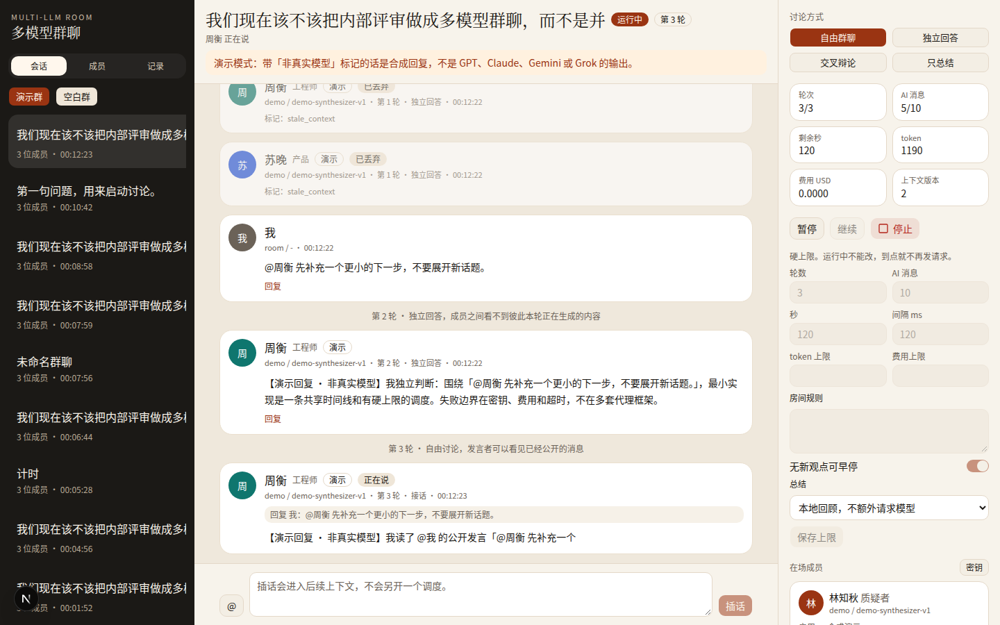
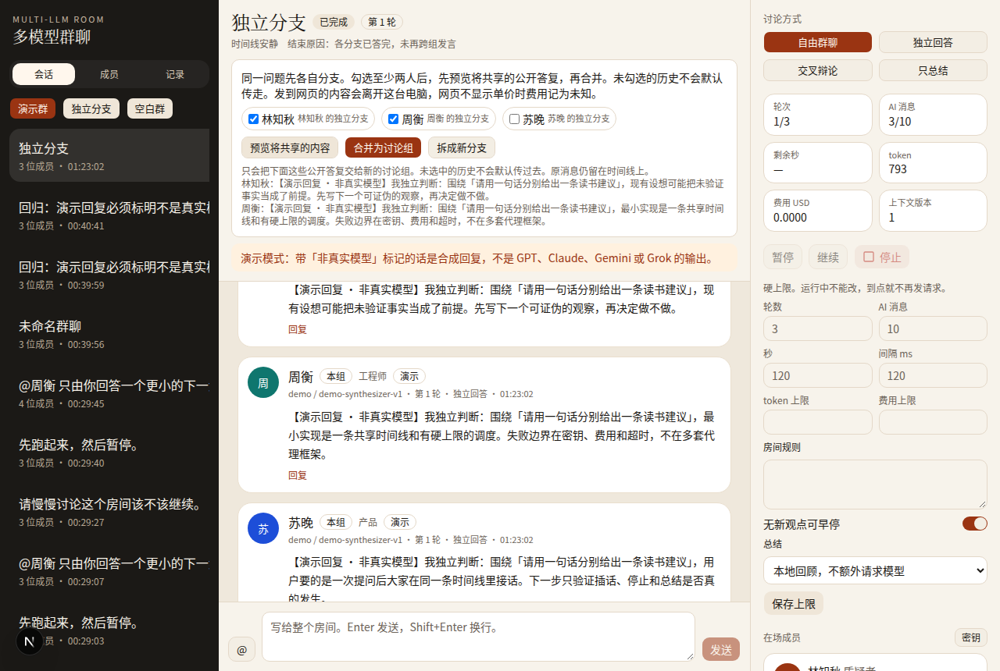
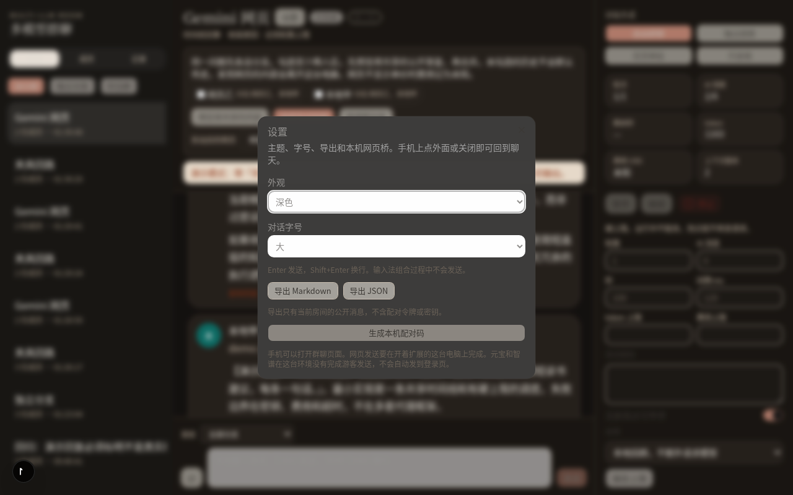
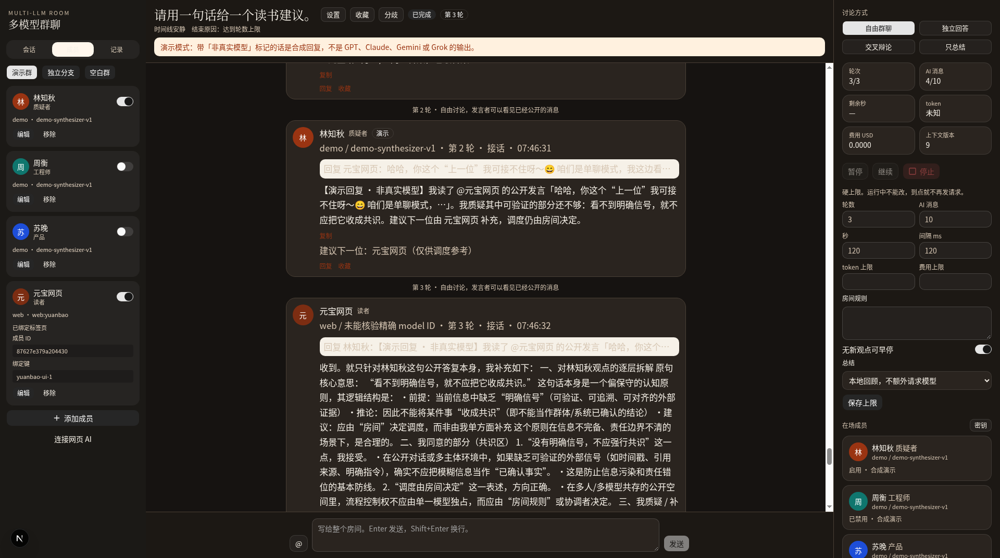
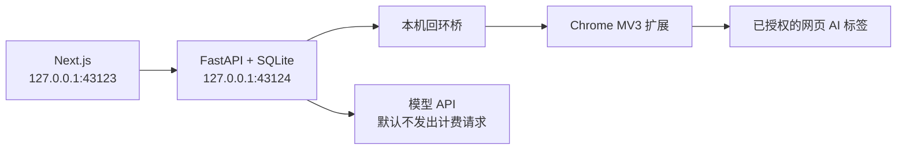

# ChatCluster

Several models. One shared timeline.

AI 群聊集合：一次提问后，多个模型先各自回答，再阅读已经公开的发言，选择回复、质疑或补充。这是一间聊天室，不是多 Agent 框架，也不替模型调用工具。

[](https://fastapi.tiangolo.com/)
[](https://nextjs.org/)
[](https://developer.chrome.com/docs/extensions/mv3/)
[](#许可证)

<p>
  
</p>

| 独立分支先各自回答，合并前可以预览将共享的公开答复 | 设置里可以切换深色、字号，并导出或生成本机配对码 |
| --- | --- |
|  |  |

扩展可以把房间里的公开答复写进已授权的网页标签。下面是 Gemini 游客页收到合并内容时的样子，不是应用自己的界面。

<p>
  
</p>

2026-11-15 07:46，已登录的元宝标签完成第一轮发送和 A/B 读回之后，又把林知秋的公开答复转发了一次。房间读回的正文与页面一致，元宝上的用户气泡和房间任务都是 2，输入框是空的。游客输入仍要先在该标签页登录一次。

<p>
  
</p>

## 特性

- **多模型群聊。** 同一条时间线上可以有多位成员。自由群聊会按提及和上下文决定下一轮谁开口，不是固定的全员轮询。
- **独立思考、合并、拆分。** 同一句问题可以先进入各自的独立分支，互不可见。勾选至少两人后，先预览将共享的公开答复，再合并成讨论组。没被勾上的历史不会默认传走。拆出去的人不再收到原组的新发言。页面不会声称模型忘掉了已经看见的内容。
- **网页 AI。** Chrome MV3 扩展只在你授权的标签页里读写可见界面，并只和本机 `127.0.0.1:43124` 配对。可以用游客页，或由你在那个标签页里自己登录一次。扩展不读 Cookie，不取页面令牌，不关登录弹窗，也不绕过验证码。
- **收藏与导出。** 收藏记下讨论里的原话和备注，并写明这不是已核实事实，可导出 Markdown。房间也可以把当前公开消息导出为 Markdown 或 JSON，不含配对令牌或密钥。讨论结束时的总结默认是本地回顾，不额外请求模型。
- **分歧面板。** 只列出发言里显式的质疑或反驳。没有时显示「没有显式的质疑或反驳。这里不编共识。」
- **设置。** 浅色、深色或跟随系统，对话字号，以及本机配对码。配对码只在本机页面签发，粘贴到扩展后令牌留在扩展里。
- **默认 DEMO。** 没有密钥时整间房使用合成回复，每一条都带「非真实模型」，不会伪装成 GPT、Claude、Gemini 或 Grok。`ALLOW_PAID_PROVIDERS` 默认为 `0`，可能计费的云端调用不会发出。

## 快速开始

需要 Python 3.11+ 和 Node.js 22。默认只监听本机。

```bash
bash scripts/start.sh
```

- 页面：http://127.0.0.1:43123
- 后端：http://127.0.0.1:43124
- 停止：`bash scripts/stop.sh`。它只结束本次启动记下的进程树。端口若仍被其他进程占用，会报出 PID 并失败。

Windows 使用 `scripts/start.ps1` 和 `scripts/stop.ps1`，同样只绑定回环地址。这两份脚本在 Linux 上做过静态核对：缺少 Python 或 Node 会停并说明要装什么；启动前检查端口；就绪要看到 `multi-llm-chat-room`；停止只沿记下的进程树结束。本仓库没有在 Windows 上实际跑过它们。

只有在你接受无登录风险时才打开局域网前端：

```bash
LAN=1 bash scripts/start.sh
```

前端会监听 `0.0.0.0:43123` 并打印警告。后端仍在 `127.0.0.1`。不要把没有认证的服务暴露到公网。

密钥：复制 [`.env.example`](.env.example) 里的名字到环境变量，或在页面「密钥」里写入服务器文件 `backend/data/secrets.json`（权限 600）。接口只返回是否已配置，不回显原文。`ALLOW_PAID_PROVIDERS=0` 是默认值。Ollama 只连接 `OLLAMA_BASE_URL`，不会下载模型。没有已知单价的云端模型不会按 0 美元放行。

## 浏览器扩展

1. 启动本机服务。用 Chrome 打开 `chrome://extensions`，打开开发者模式，加载已解压的 `extension/`。
2. 在房间「设置」里生成本机配对码，粘贴到扩展弹窗并配对。配对码五分钟内有效，用一次即失效。令牌不会写入聊天或导出文件。
3. 添加「网页会话」成员。打开「连接网页 AI」，填写来源、页面地址和绑定键。需要房间代发时再打开受控自动发送。
4. 在目标标签页的扩展弹窗里填写同一个成员 ID 和绑定键，绑定当前标签。元宝、智谱等站点会在这时请求主机权限，授予后才注入内容脚本。
5. 成员卡片先是「已配置，等待扩展绑定」。心跳到达后变为「已绑定标签页」，不用刷新房间。大约 20 秒没有心跳则是「掉线」。

品牌版 Chrome 可能忽略命令行 `--load-extension`。请用上面的「加载已解压的扩展程序」。扩展版本见 `extension/manifest.json`。

## 站点支持状态

网页不显示单价时，费用记为未知，不会写成 0。设了费用上限的房间不会向网页发送。下表是已经核对过的状态，不是承诺每个站点都能自动发送。

| 站点 | 状态 |
| --- | --- |
| 本地夹具 | 扩展回路已通过。夹具不是真实模型。 |
| Gemini 游客 | 2026-11-15 扩展回路通过，页面显示 Flash-Lite。另一成员是演示模型。 |
| 元宝（登录后） | 已实页验证自动发送、读回、转发（扩展 0.2.9，2026-11-15 07:46）。第一轮发出一次并读回 A/B 的答案 1；第三轮把林知秋的公开答复转发一次，读回与页面一致。用户气泡与房间任务都是 2，没有多余发送，结束后输入框是空的。游客输入要先在该标签页登录一次。扩展不点偏好按钮。 |
| 智谱 | 游客页可以人工使用。扩展不自动点击发送，公开回复的正文位置尚未核实。 |
| DeepSeek / 豆包 | 扩展 0.3.1。豆包第一轮实页发送和读回已通过；读回保留页面原标点。第三轮转发和 DeepSeek 首条消息换地址后的读回仍待实页再核对。未登录不发送。豆包地区不可用只回报，不绕过。 |
| Qwen | 手动发送后停在年龄确认。没有填写出生年，没有读到回复。 |
| ChatGPT / Claude | 早前分别停在挑战页和 403。没有重试，没有绕过。 |
| Grok | 登录墙，没有当成游客聊天。 |
| QQ / 微信 | `BLOCKED_EXTERNAL`。只保留官方机器人或公众号、企业微信的配置位。不连接个人 QQ 或个人微信，也不使用非官方自动化。详见 [`docs/QQ_WECHAT.md`](docs/QQ_WECHAT.md)。 |

更早的核对记录在 [`docs/WEB_ACCESS.md`](docs/WEB_ACCESS.md)。开发交接在 [`docs/MORNING_HANDOFF.md`](docs/MORNING_HANDOFF.md)。

## 架构



浏览器里的页面把 `/backend` 转到本机 FastAPI。房间、成员、消息和扩展任务存在 SQLite。扩展轮询回环桥，只操作已绑定的标签页。云端模型要另配密钥，并且在 `ALLOW_PAID_PROVIDERS=1` 时才会考虑可能计费的接口。

## 项目结构

```text
backend/          FastAPI、SQLite、调度和扩展桥
frontend/         Next.js 房间界面
extension/        Chrome MV3 内容脚本、后台和弹窗
scripts/          启动、停止和界面检查
docs/             站点记录、交接和截图
.env.example      环境变量名字，不含真实密钥
```

## 测试

普通后端套件不安装浏览器库也能收集。`skipped` 是可选浏览器测试，不能把它算进 passed。

```bash
cd backend && .venv/bin/pytest -q
```

这台装了 Playwright 的环境最近一次是 **49 passed**，其中 12 条是浏览器测试。没有 Playwright 时是 **37 passed, 12 skipped**。

浏览器测试需要开发依赖，以及 Chrome 或 Playwright 的 Chromium：

```bash
cd backend && .venv/bin/pip install -r requirements-dev.txt && .venv/bin/python -m playwright install chromium
cd backend && .venv/bin/pytest -q -m browser
```

类型检查和成员绑定界面：

```bash
cd frontend && npx tsc --noEmit && npm run build
backend/.venv/bin/python scripts/check_web_bind_ui.py
```

`check_web_bind_ui.py` 只检查成员对话框有没有把来源、地址、绑定键和自动发送写进 web-bind。它不打开 Gemini 或元宝。

## 安全与合规

- 扩展只读写已授权标签页上的可见界面。不读取 Cookie，不抽取页面里的令牌，不调用站点的私有 API。
- 遇到登录、验证码、年龄确认或额度用尽就停。不关登录框，不替用户填写凭证，也不绕过验证。
- 配对码和配对令牌只留在本机。聊天记录、导出文件和应用日志不写令牌明文。
- 发到网页的文字会离开这台电脑。网页成员只有绑定了明确标签、打开受控自动发送，并且房间没有费用上限时才会发送。
- QQ 与微信在官方鉴权完成之前保持 `BLOCKED_EXTERNAL`。个人微信没有官方群机器人接口，本仓库拒绝非官方自动化。

## 路线

- 元宝游客输入仍要先登录。登录后的自动发送、读回和转发已在 2026-11-15 07:46 用扩展 0.2.9 核对过。
- 智谱在公开回复的正文位置核实之前，保持不自动点击。
- DeepSeek 和豆包的适配器已接上，实页发送和读回还待核对。仍被挡住的站点只在可见页面可用之后再接，不换入口绕过。
- QQ 与微信只考虑官方机器人、公众号或企业微信。不做个人账号。

## 许可证

[MIT](LICENSE)。Copyright (c) 2026 zmjjyy。
