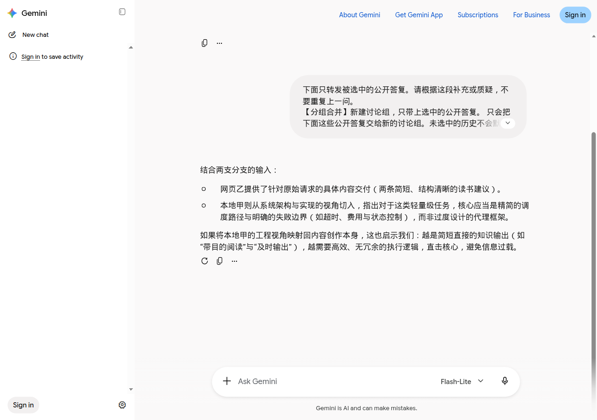
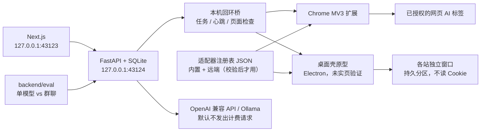

# ChatCluster

Several models. One shared timeline.

AI 群聊集合：一次提问后，多个模型先各自回答，再阅读已经公开的发言，选择回复、质疑或补充。这是一间聊天室，不是多 Agent 框架，也不替模型调用工具。

[](https://fastapi.tiangolo.com/)
[](https://nextjs.org/)
[](https://developer.chrome.com/docs/extensions/mv3/)
[](#许可证)

<p>
  
</p>

| 独立分支先各自回答，合并前可以预览将共享的公开答复 | 设置里可以切换深色、字号，并导出或生成本机配对码 |
| --- | --- |
|  |  |

扩展可以把房间里的公开答复写进已授权的网页标签。下面是 Gemini 游客页收到合并内容时的样子，不是应用自己的界面。

<p>
  
</p>

2026-11-15 07:46，已登录的元宝标签完成第一轮发送和 A/B 读回之后，又把林知秋的公开答复转发了一次。房间读回的正文与页面一致，元宝上的用户气泡和房间任务都是 2，输入框是空的。游客输入仍要先在该标签页登录一次。

<p>
  
</p>

## 特性

- **多模型群聊。** 同一条时间线上可以有多位成员。自由群聊会按提及和上下文决定下一轮谁开口，不是固定的全员轮询。
- **独立思考、合并、拆分。** 同一句问题可以先进入各自的独立分支，互不可见。勾选至少两人后，先预览将共享的公开答复，再合并成讨论组。没被勾上的历史不会默认传走。拆出去的人不再收到原组的新发言。页面不会声称模型忘掉了已经看见的内容。
- **网页 AI 和 API 混用。** 同一个房间里，网页成员和 API 成员可以一起讨论。
  - 网页成员：Chrome MV3 扩展只在你授权的标签页里读写可见界面，只和本机 `127.0.0.1:43124` 配对。可以用游客页，或由你在那个标签页里自己登录一次。游客页是否可用由站点决定、时有时无（会出现无权限、额度用完、要求登录），不保证免费可用。扩展不读 Cookie，不取页面令牌，不关登录弹窗，也不绕过验证码。
  - API 成员：走 OpenAI 兼容接口，流式输出。内置 OpenAI、DeepSeek、通义（DashScope 兼容模式）、硅基流动、OpenRouter、本机 Ollama 的预设，也可以填自定义地址。密钥只存在本机后端。
- **适配器注册表（0.5.0 起）。** 游客站（Qwen、ChatGPT、文心、智谱清言、Z.ai）的选择器和站点规则放在带版本的 `extension/adapters/registry.json`，每个角色有按顺序回退的选择器。扩展会定时从仓库拉取新版，校验通过才启用。注册表只含数据，不执行远端代码。
  - **远端更新的范围有限。** 只有这几个游客站的选择器和规则会随远端注册表改变行为；写入、点击、确认发出等流程在扩展代码里，改不了。DeepSeek、豆包、元宝的注册表条目目前**只用于页面检查**，它们的发送和读取仍由 `deepseek.js` / `doubao.js` / `yuanbao.js` 里的代码决定，站点改版时要更新扩展。Gemini 不在注册表里。
  - 用到新开关的注册表会写明 `min_extension`，旧扩展会拒绝它并继续用内置注册表。
- **页面检查与诊断快照。** 「检查当前页」不发送，只找输入框、发送键和消息容器，结果显示在扩展弹窗和房间的成员卡片上。适配一坏马上能看到。诊断快照只保留聊天栏结构，正文打码，用来写新选择器。
- **评测。** `backend/eval/` 用固定 10 道题比较单模型和群聊，输出 Markdown 和 JSON 报告。自带结果是模拟成员跑的，只证明流程能跑通。现有测试和评测**都不能证明群聊讨论比单模型更准确**。
- **收藏与导出。** 收藏记下讨论里的原话和备注，并写明这不是已核实事实，可导出 Markdown。房间也可以把当前公开消息导出为 Markdown 或 JSON，不含配对令牌或密钥。讨论结束时的总结默认是本地回顾，不额外请求模型。
- **分歧面板。** 只列出发言里显式的质疑或反驳。没有时显示「没有显式的质疑或反驳。这里不编共识。」
- **设置。** 浅色、深色或跟随系统，对话字号，以及本机配对码。配对码只在本机页面签发，粘贴到扩展后令牌留在扩展里。
- **默认演示。** 没有密钥时整间房使用合成回复，每一条都带「非真实模型」，不会伪装成 GPT、Claude、Gemini 或 Grok。`ALLOW_PAID_PROVIDERS` 默认为 `0`，可能计费的云端调用不会发出。

## 快速开始

需要 Python 3.10+ 和 Node.js 20+。默认只监听本机。

```bash
bash scripts/start.sh
```

- 页面：http://127.0.0.1:43123
- 后端：http://127.0.0.1:43124
- 停止：`bash scripts/stop.sh`。它只结束本次启动记下的进程树。端口若仍被其他进程占用，会报出 PID 并失败。

Windows 使用 `scripts/start.ps1` 和 `scripts/stop.ps1`，同样只绑定回环地址。这两份脚本在 Linux 上做过静态核对：缺少 Python 或 Node 会停并说明要装什么；启动前检查端口；就绪要看到 `multi-llm-chat-room`；停止只沿记下的进程树结束。本仓库没有在 Windows 上实际跑过它们。

要在手机上用，见下面的「手机使用」。

## 一键安装

不需要管理员，也不会把密钥写进脚本或日志。缺了 Python 或 Node 就停下并说明去哪里装，不会静默安装系统包。再跑一次是安全的：虚拟环境会复用，服务已经在听就直接告诉你地址。

```bash
bash scripts/install.sh
```

预演（只检查版本，不安装、不启动）：`bash scripts/install.sh --dry-run`

Windows（在仓库根目录）：

```powershell
powershell -NoProfile -ExecutionPolicy Bypass -File scripts\install.ps1
```

预演：在上面的命令末尾加上 `-DryRun`。

装完后终端会打印应用地址，以及加载扩展的步骤。也可以改开下面的桌面壳原型，那样不用装扩展、不用抄配对码。

## 发布包

版本号来自 `extension/manifest.json`（现在是 0.5.0）。在仓库里执行：

```bash
python3 scripts/build_release.py --out dist
```

会得到三样东西，不会上传、也不会打 tag：

- `chatclumer-<version>.zip`：后端和前端源码、`scripts/`、`extension/`、`desktop/`、`docs/`、`README.md` 和 `LICENSE`。不含 `backend/data/`、`.venv`、`node_modules`、`.next`、`.run/` 或密钥。
- `chatclumer-extension-<version>.zip`：扩展文件在 zip 根目录（含 `adapters/`），解压后到 `chrome://extensions` 加载，也可以作为商店包的底稿。
- `SHA256SUMS`：上面两个 zip 的校验和。应用包里面另有一份源文件校验和。

推送 `v*` tag 时，`.github/workflows/release.yml` 会跑测试、打这两个包，并挂到同名的 GitHub Release。普通提交不会发版。本仓库的说明不代替你自己去创建 tag。

## 手机使用（安卓 / iPhone）

网页 AI 仍然在电脑上的浏览器扩展里运行，手机只是遥控器：发消息、看回复、看现场。电脑要开机，ChatCluster 要在跑。

1. 在电脑上用手机模式启动：`LAN=1 bash scripts/start.sh`（Windows：`$env:LAN="1"; .\scripts\start.ps1`）。不加 `LAN=1` 时前端只听 `127.0.0.1`，手机连不上。
2. 在电脑上打开 http://127.0.0.1:43123 ，点顶部「手机连接」。面板列出电脑的局域网地址和 Tailscale 地址（`100.x`），二维码默认是模糊的，点一下才显示。
3. 手机扫码：
   - **安卓 App**：选「安卓 App 扫码」，用 ChatCluster 安卓 App 扫。二维码内容是 `chatclumer://pair?u=<电脑地址>&t=<口令>`。
   - **iPhone / 安卓浏览器**：选「iPhone / 浏览器扫码」，用相机扫，会打开 `http://电脑IP:43123/m/pair?token=…`，配对后进入群聊。再点 Safari「分享 → 添加到主屏幕」（安卓 Chrome 是菜单里的「添加到主屏幕」），就能像 App 一样全屏打开。iPhone 从主屏幕打开时不和 Safari 共用登录状态，第一次会让你粘贴配对链接（面板里的「复制链接」）。
4. **在外面用**：电脑和手机都装免费的 [Tailscale](https://tailscale.com/download) 并登录同一个账号，面板里会多出一个 `100.x` 地址，扫那个二维码即可。不需要也不要做端口转发或公网穿透。

安卓安装包的构建、侧载和签名见 [`android/README.md`](android/README.md)。

安全说明：

- 手机模式下只有前端 `43123` 监听 `0.0.0.0`。后端和扩展桥 `43124` 仍只绑定 `127.0.0.1`，并且拒绝所有非回环来源。
- 电脑本机访问不需要口令，和以前一样。其他设备的每个请求（页面、`/backend` 接口、事件流）都必须带配对后的 `cc_session` Cookie（HttpOnly、SameSite=Lax）或 `Authorization: Bearer <口令>`，否则接口返回 401，页面显示「请先在电脑上扫码」。认证在前端服务器按真实连接地址判断，不信任 `X-Forwarded-For`。
- 口令 256 位随机，首次用 `LAN=1` 启动时生成，存在 `backend/data/mobile_token.json`（已 gitignore，不会打印到终端或日志）。同一 IP 在 10 分钟内提交 10 个不同的错误口令后会被暂时拒绝。
- 换口令：面板里点「更换口令」，或 `cd frontend && npm run mobile-token -- rotate`。换完旧的配对立即失效，手机要重新扫码。
- 二维码和配对链接等同于钥匙。只在自己家的 Wi-Fi 或 Tailscale 里用，咖啡馆、公司等公共 Wi-Fi 上不要开手机模式。连接是 http，同一 Wi-Fi 里能抓包的人理论上能看到内容；Tailscale 链路本身是加密的。
- 给 App 用的探测接口：`GET /m/ping` 返回 `{"app":"chatclumer","version":"…","auth":true|false}`，不含任何秘密。

## 桌面壳（原型）

尚未在真实网站上验证。细节和限制见 [`docs/DESKTOP.md`](docs/DESKTOP.md)。

```bash
cd desktop && npm install && npm start
```

它打开 `http://127.0.0.1:43123`，并为注册表里的每个网页 AI 开一个带持久分区的窗口。主进程走本机回环自动配对。页面上的写入、单击和「已填入，未发送」仍是 `extension/` 里的那批脚本。不读 Cookie，不绕过登录或验证码。Windows（nsis / portable）和 Linux（AppImage / deb）的 electron-builder 配置在 `desktop/package.json`，不在 tag 的发布流程里自动构建。

**API 成员：** 添加成员时选一个提供方。API Base 留空就用预设地址；本机服务（Ollama、LM Studio，或任何 `127.0.0.1` 上的兼容接口）视为零费用。选 Ollama 时，页面会列出本机已有的模型。云端接口要先配好密钥，再在设置里打开「允许可能计费的调用」。

密钥：复制 [`.env.example`](.env.example) 里的名字到环境变量，或在页面「密钥」里写入服务器文件 `backend/data/secrets.json`（权限 600）。接口只返回是否已配置，不回显原文。`ALLOW_PAID_PROVIDERS=0` 是默认值。Ollama 只连接 `OLLAMA_BASE_URL`，不会下载模型。没有已知单价的云端模型不会按 0 美元放行。

## 浏览器扩展

1. 启动本机服务。用 Chrome 打开 `chrome://extensions`，打开开发者模式，加载已解压的 `extension/`。
2. 在房间「设置」里生成本机配对码，粘贴到扩展弹窗并配对。配对码五分钟内有效，用一次即失效。令牌不会写入聊天或导出文件。
3. 添加「网页会话」成员。打开「连接网页 AI」，填写来源、页面地址和绑定键。需要房间代发时再打开受控自动发送。
4. 在目标标签页的扩展弹窗里填写同一个成员 ID 和绑定键，绑定当前标签。元宝、智谱等站点会在这时请求主机权限，授予后才注入内容脚本。
5. 成员卡片先是「已配置，等待扩展绑定」。心跳到达后变为「已绑定标签页」，不用刷新房间。大约 20 秒没有心跳则是「掉线」。
6. 绑定后，扩展每 30 秒做一次页面检查，卡片上会显示「页面检查：输入框、发送键正常」或缺了什么。弹窗里也可以手动「检查当前页」，或「导出诊断快照」。
7. 扩展弹窗显示当前注册表的版本和来源。远端地址默认是本仓库的 `extension/adapters/registry.json`，可以改成自己的 https 地址，填 `off` 就关闭远端更新。

品牌版 Chrome 可能忽略命令行 `--load-extension`。请用上面的「加载已解压的扩展程序」。扩展版本见 `extension/manifest.json`。

## 站点支持状态

网页不显示单价时，费用记为未知，不会写成 0。设了费用上限的房间不会向网页发送。下表是已经核对过的状态，不是承诺每个站点都能自动发送。

| 站点 | 状态 |
| --- | --- |
| 本地夹具 | 扩展回路已通过。夹具不是真实模型。 |
| Gemini 游客 | 2026-11-15 扩展回路通过，页面显示 Flash-Lite。另一成员是演示模型。 |
| 元宝（登录后） | 已实页验证自动发送、读回、转发（扩展 0.2.9，2026-11-15 07:46）。第一轮发出一次并读回 A/B 的答案 1；第三轮把林知秋的公开答复转发一次，读回与页面一致。用户气泡与房间任务都是 2，没有多余发送，结束后输入框是空的。游客输入要先在该标签页登录一次。扩展不点偏好按钮。 |
| Qwen / Z.ai / 文心 / 智谱清言（游客，可用性不稳定） | 扩展 0.4.2–0.4.4 实页已通过（2026-11-15）；0.5.0 实页：文心、Z.ai 发送和读回通过（文心转发也通过），智谱清言「已填入，未发送」，Qwen 游客发送被站点以无权限拒绝。游客可用与否由站点决定，不保证免费可用。共用 `extension/guest.js`，选择器在注册表里。文心的 wenxin.baidu.com、chat.baidu.com、yiyan.baidu.com 算同一个绑定。Qwen 若提示没有权限，回报「千问游客发送被拒绝，可能需要登录」；年龄确认弹窗不点。 |
| ChatGPT（游客） | 不可靠。游客额度用完后页面要求「Sign in to continue」，扩展写入前就识别并回报，不写入、不重试。 |
| DeepSeek / 豆包（要先登录） | 实页发送和读回已通过。DeepSeek 要放在单独的可见窗口里，后台标签页可能不渲染消息列表。未登录不发送。豆包地区不可用只回报，不绕过。 |
| 0.5.0 注册表版本 | 改成从注册表编译后，用同一批真实 DOM 测试回归过；实页结果见上一行。 |
| 0.5.1 实页（2026-11-15） | Qwen 游客、文心（含第二轮转发）、DeepSeek（用户气泡已被虚拟列表移走）发送并读回，与页面一致；测试后没有再出现「已声明」报错。Z.ai 用户消息发出后页面显示「Verification required, please try again」，房间当时只回报通用超时。智谱清言仍失败：点到了外层 `div.enter.is-main-chat`。 |
| 0.5.2 | 智谱清言改为直接点内层图标（注册表 `click_inner`），找不到才退回中心点命中；Z.ai 发出后出现人机验证时立即回报（注册表 `error_texts`）；弹窗的注册表状态不再显示过时的比较。只有夹具和测试结果，**实页还没跑**。 |
| Kimi / Grok / Copilot / Hugging Face Chat | 2026-11-15 试过：要登录才有回复，不当成游客站。 |
| 千问 qianwen.com（tongyi.com 跳转）/ 秘塔 metaso.cn | 首次发送出现滑块验证，不代做，未接入。 |
| Perplexity | 游客回复只有「注册并重复您的请求」，没有实际用处，未接入。 |
| duck.ai / you.com / phind.com | duck.ai 本机网络连不上；you.com 已无游客聊天；phind.com 已下线。 |
| Claude | 早前 403。没有重试，没有绕过。 |
| QQ / 微信 | `BLOCKED_EXTERNAL`。只保留官方机器人或公众号、企业微信的配置位。不连接个人 QQ 或个人微信，也不使用非官方自动化。详见 [`docs/QQ_WECHAT.md`](docs/QQ_WECHAT.md)。 |

更早的核对记录在 [`docs/WEB_ACCESS.md`](docs/WEB_ACCESS.md)。开发交接在 [`docs/MORNING_HANDOFF.md`](docs/MORNING_HANDOFF.md)。

## 架构



- **前后端。** 浏览器里的页面把 `/backend` 转到本机 FastAPI。房间、成员、消息和扩展任务存在 SQLite。
- **扩展。** 轮询回环桥，只操作已绑定的标签页。游客站的选择器和规则来自注册表：内置一份，远端一份。DeepSeek、豆包、元宝的注册表条目只供页面检查。远端注册表只有在结构合法、版本更新、选择器都能解析时才启用，任何一项不满足都继续用内置。
- **桌面壳。** 原型，尚未在真实网站上验证。它加载同一份注册表和内容脚本，用本机回环自动配对，不读 Cookie。
- **安卓客户端。** 手机上的 WebView，连到电脑的页面。见 [`android/README.md`](android/README.md)。
- **页面检查。** 结果随心跳回到后端，显示在成员卡片上。
- **API 成员。** 和网页成员共用同一套调度。云端模型要另配密钥，并且只有在 `ALLOW_PAID_PROVIDERS=1` 时，才会考虑可能计费的接口。

## 和同类产品的取舍

详见 [`docs/COMPETITOR_APPROACHES.md`](docs/COMPETITOR_APPROACHES.md)。

| | ChatALL | GodMode | ChatHub | Cherry Studio / LobeHub | 本项目 |
| --- | --- | --- | --- | --- | --- |
| 网页 AI | 调网页私有接口 | 内嵌网页，写死的选择器 | 调网页私有接口，或用自己的 API Key | 基本不做 | 只操作可见页面，不读 Cookie、不调私有接口 |
| 适配坏了 | 发新版（仓库已归档） | 发新版 | 转向 API 和自营服务 | 不涉及 | 改注册表 JSON，扩展自动拉取；页面检查马上报出哪个角色坏了 |
| API | 有 | 少量 | 有 | 主力 | OpenAI 兼容 + Ollama，和网页成员同房 |
| 分发 | 桌面安装包 | 桌面安装包 | 扩展商店 + 网页 | 安装包 / Docker | 一键安装脚本和带校验和的发布包；桌面壳是原型，未在实页验证 |

## 项目结构

```text
backend/          FastAPI、SQLite、调度和扩展桥
backend/eval/     评测：固定题集、单模型 vs 群聊、报告（自带的是模拟结果）
frontend/         Next.js 房间界面
frontend/server/  前端服务器（包住 Next）：手机/局域网配对认证、/m/ping、/m/pair
extension/        Chrome MV3 内容脚本、后台和弹窗
extension/adapters/  适配器注册表（registry.json）、结构校验、运行时（页面检查、诊断快照）
desktop/          Electron 桌面壳原型（复用扩展脚本和注册表，未实页验证）
android/          安卓远程客户端（WebView）。说明见 android/README.md
scripts/          安装、启动、停止、发布包和界面检查
docs/             站点记录、桌面壳说明、交接和截图
.env.example      环境变量名字，不含真实密钥
```

## 测试


手机访问：`cd frontend && npm run test:mobile`（认证层 node 单测，pytest 也会调用），`backend/tests/test_mobile_access.py`（后端和扩展桥拒绝非回环来源）。界面检查：`LAN=1 bash scripts/start.sh` 后运行 `python scripts/check_mobile_ui.py <电脑局域网IP>`，截图里二维码保持模糊。安卓客户端：`cd android && ./gradlew test`，说明见 [`android/README.md`](android/README.md)。

普通后端套件不安装浏览器库也能收集。`skipped` 是可选浏览器测试，不能把它算进 passed。

```bash
cd backend && .venv/bin/pytest -q
```

安装脚本的预演、发布包内容和桌面壳的协议 / 夹具 DOM 测试都在这套里面（`backend/tests/test_distribution.py`）。夹具测试会在第一次运行时用 npm 安装 `jsdom`，不需要 Playwright。

不装 Playwright 时，项目自带的 venv 跑出 **61 passed, 7 skipped**（跳过的都是浏览器测试）。浏览器测试是在另一个装了 Playwright 的环境里跑的：真实 DOM 回放、注册表页面检查、远端注册表的接受与拒绝、诊断快照打码等。

改了 `extension/adapters/registry.json` 之后，要重新生成内置副本：

```bash
python3 scripts/build_registry.py
```

评测：

```bash
cd backend && .venv/bin/python -m eval.run_eval --mock --out eval/results/mock
```

浏览器测试需要开发依赖，以及 Chrome 或 Playwright 的 Chromium：

```bash
cd backend && .venv/bin/pip install -r requirements-dev.txt && .venv/bin/python -m playwright install chromium
cd backend && .venv/bin/pytest -q -m browser
```

类型检查和成员绑定界面：

```bash
cd frontend && npx tsc --noEmit && npm run build
backend/.venv/bin/python scripts/check_web_bind_ui.py
```

`check_web_bind_ui.py` 只检查成员对话框有没有把来源、地址、绑定键和自动发送写进 web-bind。它不打开 Gemini 或元宝。

## 安全与合规

- 扩展只读写已授权标签页上的可见界面。不读取 Cookie，不抽取页面里的令牌，不调用站点的私有 API。
- 远端注册表只是数据：选择器、正则文本、提示文字和少数开关。校验时，不认识的键、超长内容和无法解析的选择器都会导致整份拒绝，绝不执行远端代码。
- 诊断快照里的正文、`data-*` 里的文字、输入框内容、图片地址和链接都会去掉或打码，导出前不上传。
- API 密钥只存在本机后端（文件权限 600），不回显到前端，也不写进日志和数据库。
- 遇到登录、验证码、年龄确认或额度用尽就停。不关登录框，不替用户填写凭证，也不绕过验证。
- 配对码和配对令牌只留在本机。聊天记录、导出文件和应用日志不写令牌明文。
- 发到网页的文字会离开这台电脑。网页成员只有绑定了明确标签、打开受控自动发送，并且房间没有费用上限时才会发送。
- QQ 与微信在官方鉴权完成之前保持 `BLOCKED_EXTERNAL`。个人微信没有官方群机器人接口，本仓库拒绝非官方自动化。

## 路线

- **0.5.x：** 0.5.1/0.5.2 已在千问、文心、DeepSeek、智谱清言、Z.ai 实页通过。千问和 Z.ai 游客通道时好时坏（权限提示、人机验证），插件会直接回报。
- **分发：** 一键安装和 tag 上的发布包已经接上。桌面壳能打开本机页面并按注册表嵌入站点，但是原型：没有在真实网站上跑过。规格和限制见 [`docs/DESKTOP.md`](docs/DESKTOP.md) 与 [`docs/COMPETITOR_APPROACHES.md`](docs/COMPETITOR_APPROACHES.md)。
- **评测：** 用真实成员（本机 Ollama 免费）跑一遍 `backend/eval`，替换自带的模拟结果。
- **站点：** 元宝游客输入仍要先登录。仍被挡住的站点只在可见页面可用之后再接，不换入口绕过。
- **QQ 与微信：** 只考虑官方机器人、公众号或企业微信，不做个人账号。

## 许可证

[MIT](LICENSE)。Copyright (c) 2026 zmjjyy。
